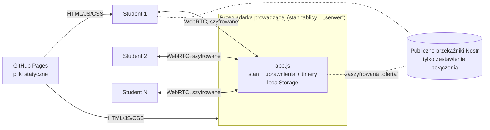

<p></p>

# murmur

**Każdy głos ma znaczenie. · *Every voice matters.***

Narzędzie na zajęcia, wykłady i webinary — by także ci, którzy zwykle nie zabierają głosu, mogli się wypowiedzieć.
Uczestnicy wchodzą przez link albo kod QR, bez konta, i dorzucają pytania, wątpliwości, pomysły
i krótkie reakcje na kartkach w sekcjach. Mogą głosować ▲ i odpowiadać na krótkie quizy
(jednokrotny lub wielokrotny wybór). Domyślnie wszystko jest anonimowe.

Działa wyłącznie w przeglądarce (GitHub Pages), **bez backendu i bez bazy danych**. Interfejs jest **PL / EN**.

> *EN — A browser-only classroom tool: participants join via link or QR (no account, anonymous by
> default) and drop questions, doubts, ideas and quick reactions as cards; voting, grouping and short
> quizzes included. No backend — the instructor's browser tab acts as the server.*

---

- [Szybki start (prowadząca/y)](#szybki-start-prowadzącay)
- [Instrukcja dla uczestników (do wklejenia)](#instrukcja-dla-uczestników-do-wklejenia)
- [Funkcje](#funkcje)
- [Jak to działa](#jak-to-działa)
- [Gdzie są tablice i jak długo żyją](#gdzie-są-tablice-i-jak-długo-żyją)
- [Bezpieczeństwo i prywatność](#bezpieczeństwo-i-prywatność)
- [Wykorzystane technologie](#wykorzystane-technologie)
- [Struktura plików](#struktura-plików)
- [Wdrożenie i konfiguracja](#wdrożenie-i-konfiguracja)
- [Szablony tablic](#szablony-tablic)
- [Wersje i wydania](#wersje-i-wydania)
- [Wyszukiwarki i AI (SEO/GEO)](#wyszukiwarki-i-ai-seogeo)
- [Test lokalny](#test-lokalny)
- [Dostępność](#dostępność)
- [Ograniczenia](#ograniczenia)
- [Zgłoszenia i pomysły](#zgłoszenia-i-pomysły)
- [Licencje i autorstwo](#licencje-i-autorstwo)

---

## Szybki start (prowadząca/y)

1. Otwórz `https://<login>.github.io/murmur/`, a następnie wybierz **nową tablicę** (tytuł i sekcje) albo **szablon**.
2. Kliknij **QR**, żeby wyświetlić na cały ekran (na rzutnik) kod QR, adres i **krótki kod** do przepisania (np. `K7M2P-9XQ4R`). Na webinarze użyj **Udostępnij**, skopiuj link i wklej go na czat (Teams, Moodle).
3. Opcjonalnie kliknij **🙈 Ukryj**, jeśli każdy ma najpierw pomyśleć sam. Kartki odsłaniasz ręcznie albo timerem.
4. Kliknij **Quiz**, a potem **▶ Start** (opcjonalnie z limitem czasu). Następnie **Zamknij odpowiedzi** i **Pokaż wyniki**.
5. Na koniec wybierz **Eksport**: `.md` (notatka), `.png` (zrzut), `.json` (do ponownego wczytania), druk/PDF.

**Nie zamykaj karty z tablicą w trakcie zajęć.** To ona jest „serwerem”. Odświeżenie jest bezpieczne,
bo stan, link i timery zostają, a uczestnicy podłączą się sami.

Przed pierwszymi zajęciami w nowej sali zrób jedną próbę: laptop plus telefon na danych komórkowych
(patrz [Ograniczenia](#ograniczenia)).

## Instrukcja dla uczestników (do wklejenia)

> **PL:** Zeskanuj kod QR telefonem albo otwórz link. Przy komputerze w sali możesz też wejść na `magtk.github.io/murmur` i wpisać kod z ekranu (np. `K7M2P-9XQ4R`). Nie trzeba się logować ani niczego instalować.
> Wpisz myśl w polu „Dorzuć swoją myśl…” i naciśnij Enter. Wpisy są anonimowe.
> Możesz głosować ▲ na kartki innych i edytować lub usuwać swoje (✎ / ×).
> Gdy pojawi się quiz, zaznacz odpowiedź i kliknij „Wyślij odpowiedź”. Do zamknięcia quizu można ją zmienić.
> Przycisk **EN/PL** zmienia język.
>
> **EN:** Scan the QR code with your phone or open the link. On a lab computer you can also go to `magtk.github.io/murmur` and type the code from the screen (e.g. `K7M2P-9XQ4R`). No login, nothing to install.
> Type into “Drop a thought…” and press Enter. Your cards are anonymous.
> You can vote ▲ on others' cards and edit/delete your own (✎ / ×).
> When a quiz appears, pick your answer and click “Send answer”. You can change it until the quiz closes.
> The **EN/PL** button switches the language.

## Funkcje

| Obszar | Co robi |
|---|---|
| **Wejście** | Kod QR na cały ekran, link albo **kod z 10 znaków** do wpisania ręcznie (`K7M2P-9XQ4R`, bez mylących 0/O/1/L). Bez konta. |
| **Kartki** | Sekcje z tytułami i kolorami. Dodawanie Enterem, edycja i usuwanie własnych kartek. Prowadząca może wszystko. |
| **Anonimowość** | Domyślnie **anonimowo**: podpis w ogóle nie jest zapisywany. Opcjonalny tryb **pseudonimów** z losowaniem 🎲. |
| **„Najpierw pomyśl sam”** | 🙈 Ukryj: każdy widzi tylko swoje kartki i liczbę ukrytych. Odsłonięcie ręczne albo **timer** 1–10 min. |
| **Głosowanie** | ▲ jeden głos na kartkę na osobę. Sortowanie: najnowsze / najstarsze / najwięcej głosów. |
| **Grupowanie** | Przeciąganie za uchwyt ⠿ (mysz i dotyk). Na kartkę tworzy grupę, na sekcję przenosi. Nazwy grup, suma głosów. Domyślnie tylko prowadząca; opcjonalnie wszyscy. |
| **Quizy** | 1–n pytań jednokrotnego lub wielokrotnego wyboru. Start / zamknij / pokaż wyniki z poprawnymi odpowiedziami, opcjonalny limit czasu z automatycznym pokazaniem wyników. |
| **Głosowania (ankiety)** | Quiz bez poprawnych odpowiedzi: tak/nie, 1 z 2, 1 z 3 (jeden wybór) albo kilka opcji. Wyniki pokazują tylko rozkład głosów. Przełącznik „głosowanie / ankieta” w edycji quizu. |
| **Licznik** | `18 osób · ✎ 12`: połączeni oraz ile **osób** (nie kartek) już coś dorzuciło. Uczestnicy widzą dyskretne `✎ 12`. |
| **Eksport** | `.json` (całość lub szablon), `.md` (z grupami i wynikami quizów), `.png`, druk/PDF. |
| **Język** | PL / EN, osobno dla każdej osoby. Domyślnie język przeglądarki, a `?lang=en` wymusza angielski. |
| **Wygląd** | Styl magtk.github.io, motyw auto / jasny / ciemny, tryb rzutnika (A+), układ działa na telefonie. |
| **Szablony** | Pliki `.json` w repo (`boards/`), widoczne na ekranie startowym. |

## Jak to działa



1. **GitHub Pages** serwuje tylko pliki statyczne. Nie widzi treści tablicy.
2. Prowadząca tworzy tablicę. Przeglądarka generuje **kod pokoju** i **parę kluczy ECDSA P-256**. Link ma postać `…/murmur/#k7m2p-9xq4r`: **4 znaki losowe + 6 znaków odcisku** (skrótu SHA-256) klucza publicznego prowadzącej. Ten sam kod można wpisać na stronie głównej.
3. Uczestnik otwiera link. Przeglądarki odnajdują się przez **publiczne przekaźniki Nostr** (protokół sygnalizacji WebRTC, biblioteka Trystero). Przez przekaźniki idą wyłącznie **zaszyfrowane** (AES-GCM, klucz z kodu pokoju) opisy połączenia. Potem dane płyną **bezpośrednio** między przeglądarkami (WebRTC DataChannel, szyfrowanie DTLS).
4. **Weryfikacja prowadzącej:** uczestnik wysyła losowe wyzwanie, a prowadząca podpisuje je kluczem prywatnym i odsyła klucz publiczny. Uczestnik sprawdza, czy skrót klucza zaczyna się od odcisku z kodu, i weryfikuje podpis. Podrobienie 6-znakowego odcisku (30 bitów) wymagałoby około miliarda prób generowania klucza, czyli dni obliczeń, a nie minut w trakcie zajęć. Linki z wersji 1.0–1.1 mają dłuższy, 12-znakowy odcisk i dalej działają.
5. **Stan trzyma tylko prowadząca.** Uczestnicy wysyłają operacje (`dodaj`, `edytuj`, `głosuj`, `przenieś`, `odpowiedz`…). Przeglądarka prowadzącej sprawdza uprawnienia i limit (~30 operacji / 10 s), zapisuje stan i odsyła każdemu jego widok. W trybie ukrytym każdy dostaje wtedy tylko swoje kartki.
6. **Timery** (odsłonięcie, czas quizu) liczy przeglądarka prowadzącej. Uczestnicy dostają czas do końca i odliczają lokalnie.
7. Odświeżenie karty prowadzącej odtwarza stan z `localStorage` i ten sam link, a uczestnicy łączą się ponownie.

Komunikaty między przeglądarkami: `chal` / `proof` (weryfikacja), `hello` (identyfikator i pseudonim),
`op` (operacja uczestnika), `state` (widok tablicy dla danej osoby).

## Gdzie są tablice i jak długo żyją

**Tablice nie są przechowywane w repozytorium ani na żadnym serwerze.** GitHub Pages serwuje tylko pliki
aplikacji. Każda tablica istnieje wyłącznie w przeglądarce osoby, która ją założyła (`localStorage`),
więc gdy ktoś inny używa murmur z tego adresu, jego tablice nie trafiają do repo i nie są tu widoczne.

Tablice są z założenia **tymczasowe** (na zajęcia, wykład, webinar). Trwałe materiały lepiej trzymać
w Moodle albo w notesie zajęć w Teams.

| Co | Ile żyje | Co potem |
|---|---|---|
| Tablica prowadzącej | **21 dni od ostatniej zmiany** (Ustawienia → *Ważność*: 7 / 14 / 21 / 30 dni) | 3 dni przed końcem pojawia się pasek *Pobierz .json / Przedłuż o 7 dni* |
| Wygasła tablica | jeszcze 7 dni | okno: *Pobierz .json / .md / Przedłuż / Usuń teraz*; bez decyzji usuwa się sama |
| Kopia ostatniego widoku u uczestnika | 30 dni | usuwa się automatycznie przy kolejnym otwarciu murmur |

Każda zmiana na tablicy (kartka, głos, quiz) liczy się jako „ostatnia zmiana”. Samo otwarcie nie przedłuża ważności.
Zapisany `.json` można później wczytać (*Więcej → Wczytaj tablicę z pliku*) i kontynuować.

## Bezpieczeństwo i prywatność

- **Brak serwera aplikacji, bazy, kont, cookies i analityki.** Okienko zgody na cookies nie jest potrzebne: aplikacja zapisuje w `localStorage` wyłącznie dane niezbędne do działania usługi, o którą prosi użytkownik (tablica, losowy identyfikator uczestnika, język, motyw, ostatni widok tablicy), a nie do śledzenia. Pełna informacja dla użytkowników jest pod linkiem *Prywatność* w stopce strony głównej. Treść tablicy istnieje tylko w przeglądarce prowadzącej (`localStorage`) i w pamięci przeglądarek uczestników.
- **Część linku po `#` nie jest wysyłana** do GitHub Pages ani nigdzie indziej. Kto ma link, może dołączyć, więc link jest jedynym „uprawnieniem”. Na nową grupę twórz nową sesję.
- **Tryb anonimowy (domyślny):** podpis nie jest zapisywany ani eksportowany. Prowadząca nie wie, kto co napisał. Widzi jedynie, że kilka kartek pochodzi od tej samej, nienazwanej osoby, bo do uprawnień (edycja własnych kartek, jeden głos) używany jest skrót SHA-256 losowego identyfikatora przeglądarki.
- **Tryb pseudonimów:** zapisywany jest pseudonim, który uczestnik sam wybiera albo losuje.
- **Co widać na poziomie sieci:**
  - przekaźniki Nostr widzą adresy IP łączących się przeglądarek i zaszyfrowane wiadomości sygnalizacyjne (nie treść tablicy);
  - serwery STUN (Google, Cloudflare) pomagają ustalić publiczny adres do połączenia P2P;
  - **uczestnicy tego samego pokoju łączą się ze sobą bezpośrednio i technicznie mogą poznać swoje adresy IP.** To cecha każdego P2P.
- Eksporty (`.json`, `.md`, `.png`) zapisują się lokalnie na komputerze osoby, która je robi.

## Wykorzystane technologie

Wszystko jest dołączone w `lib/`: bez CDN, bez Google Fonts. Strona łączy się tylko z przekaźnikami Nostr i STUN.

| Komponent | Wersja | Do czego | Licencja | Plik |
|---|---|---|---|---|
| [Trystero](https://github.com/dmotz/trystero) (+ `@trystero-p2p/nostr`, `@noble/secp256k1`) | 0.26.0 | Połączenia WebRTC i sygnalizacja przez Nostr, szyfrowanie sygnalizacji | MIT | `lib/trystero.js` |
| [html-to-image](https://github.com/bubkoo/html-to-image) | 1.11.13 | Eksport tablicy do `.png` | MIT | `lib/html-to-image.js` |
| [qrcode-generator](https://github.com/kazuhikoarase/qrcode-generator) | 2.0.4 | Kod QR (SVG) | MIT | `lib/qrcode.js` |
| [DM Mono](https://github.com/googlefonts/dm-mono) (via @fontsource 5.3.0) | — | Krój interfejsu | SIL OFL 1.1 | `lib/fonts/` |
| [Fraunces](https://github.com/undercasetype/Fraunces) (via @fontsource 5.3.0) | — | Krój tytułów | SIL OFL 1.1 | `lib/fonts/` |
| Web Crypto API (przeglądarka) | — | ECDSA P-256 (podpis), SHA-256 (odciski, identyfikatory) | — | — |
| WebRTC, BroadcastChannel, localStorage, Pointer Events | — | Połączenia P2P, tryb testowy, zapis stanu, przeciąganie | — | — |

Biblioteki są zbudowane do pojedynczych modułów ES (esbuild, minifikacja). Kod aplikacji to czysty JavaScript
(moduły ES) bez frameworka i bez kroku budowania.

## Struktura plików

```
murmur/
├── index.html            szkielet strony
├── app.js                cała logika: model, sieć, prowadząca, uczestnik, eksport
├── i18n.js               teksty interfejsu PL / EN
├── style.css             wygląd (zmienne kolorów na początku pliku)
├── img/                  logo (SVG), favicon, ikona telefonu, avatar 500×500, podgląd linku 1280×640
├── boards/               szablony tablic
│   ├── index.json        lista szablonów na ekranie startowym
│   └── *.json            szablony PL i EN (*-en.json)
├── lib/                  biblioteki zewnętrzne (zminifikowane)
│   ├── trystero.js
│   ├── html-to-image.js
│   ├── qrcode.js
│   ├── THIRD_PARTY_LICENSES.txt
│   └── fonts/            DM Mono, Fraunces (woff2) + fonts.css + licencje OFL
├── LICENSE.md            licencja PolyForm Noncommercial 1.0.0
├── COMMERCIAL.md         kiedy potrzebna licencja komercyjna (PL/EN)
├── CHANGELOG.md          historia zmian (wersje)
├── SECURITY.md           jak zgłaszać podatności
├── CONTRIBUTING.md       zasady wkładu i licencja wkładu (PL/EN)
├── .github/ISSUE_TEMPLATE/  formularze zgłoszeń (błąd, pomysł) PL/EN
├── llms.txt              opis dla wyszukiwarek i asystentów AI
├── sitemap.xml           mapa strony dla wyszukiwarek
├── robots.txt            wzór do skopiowania do katalogu głównego domeny
├── .nojekyll             GitHub Pages serwuje pliki bez przetwarzania przez Jekyll
└── README.md
```

## Wdrożenie i konfiguracja

1. Utwórz repo `murmur` i wgraj do niego zawartość folderu.
2. Wybierz Settings → Pages → *Deploy from a branch* → `main` / `(root)`.
3. Adres to `https://<login>.github.io/murmur/`.

Nic nie trzeba edytować. **Nazwa w nagłówku** i **identyfikator pokoi** (`APP_ID`) wyliczają się z nazwy
repo w adresie. Opcje na początku `app.js`:

| Stała | Domyślnie | Kiedy zmienić |
|---|---|---|
| `BRAND_OVERRIDE` | `''` (nazwa repo) | Gdy chcesz inną nazwę w nagłówku niż nazwa repo |
| `TURN` | `[]` | Gdy sieć uczelni blokuje P2P: dopisz własny serwer TURN |

Język: przycisk **EN/PL** albo `?lang=en` / `?lang=pl` w linku przed `#`.
Kolory: zmienne CSS na początku `style.css`.

## Szablony tablic

Dodaj plik do `boards/` i wpis do `boards/index.json`:

```json
{ "file": "moj.json", "title": "Nazwa na liście", "desc": "krótki opis", "lang": "pl" }
```

`lang` (`pl` / `en`) sprawia, że szablon widać tylko przy tym języku interfejsu. Bez `lang` widać go zawsze.
Bezpośredni link startujący od szablonu: `…/murmur/?t=boards/moj.json`.

Format (pola opcjonalne można pominąć):

```json
{
  "title": "Tytuł",
  "sections": ["Prosta sekcja", { "title": "Sekcja z kolorem", "color": "teal" }],
  "settings": { "showNames": false, "votes": true, "hidden": false, "drag": "host", "locked": false, "sort": "new" },
  "quizzes": [
    {
      "title": "Quiz",
      "questions": [
        { "text": "Jednokrotny wybór", "options": ["A", "*B poprawna", "C"] },
        { "text": "Wielokrotny wybór", "options": ["*A", "*B", "C"] }
      ]
    },
    {
      "title": "Głosowanie",
      "poll": true,
      "questions": [
        { "text": "Tak czy nie?", "options": ["Tak", "Nie"] },
        { "text": "Zaznacz wszystkie pasujące", "multi": true, "options": ["A", "B", "C"] }
      ]
    }
  ]
}
```

- `color`: `amber` (złoty), `green`, `rose` (pomarańczowy), `teal`, `violet`, `sky`
- `*` na początku odpowiedzi oznacza poprawną; więcej niż jedna poprawna daje automatycznie wielokrotny wybór (można wymusić `"multi": true/false`)
- `poll: true`: głosowanie/ankieta — bez poprawnych odpowiedzi (`*` jest ignorowana), wyniki bez ✓; wielokrotny wybór ustaw przez `"multi": true`
- `showNames`: `false` = anonimowo (domyślnie), `true` = pseudonimy
- `hidden`: `true` = start z ukrytymi kartkami
- `drag`: `host` (domyślnie) albo `all`, czyli kto może grupować i przenosić
- `sort`: `new` | `old` | `votes`

Eksport „Zapisz całość (.json)” też jest poprawnym plikiem do wczytania, więc można kontynuować pracę na następnych zajęciach.

W repo są szablony: *Wykład — pytania i reakcje*, *Retrospektywa zajęć*, *Burza mózgów: zagrożenia w sieci*,
*Szybki quiz*, *Głosowanie (ankieta)*, każdy w wersji PL i EN.

## Wersje i wydania

Historia zmian jest w [`CHANGELOG.md`](CHANGELOG.md), a numer wersji w stopce strony głównej (`APP_VERSION` w `app.js`).
Numeracja [SemVer](https://semver.org/): `1.2.0` → poprawki `1.2.1`, nowe funkcje `1.3.0`, zmiany niezgodne wstecz `2.0.0`.

Przy każdym wydaniu:
1. dopisz sekcję w `CHANGELOG.md` i zmień `APP_VERSION`;
2. commit, podpisany tag i push:
   ```bash
   git tag -s v1.2.0 -m "murmur 1.2.0"
   git push origin main v1.2.0
   ```
3. na GitHubie: **Releases → Draft a new release → tag** i wklej sekcję z changeloga.

## Wyszukiwarki i AI (SEO/GEO)

- `index.html` zawiera statyczny opis (PL/EN) widoczny dla wyszukiwarek i crawlerów AI, które nie wykonują JavaScriptu, a także dane strukturalne schema.org (`WebApplication`) i znaczniki Open Graph.
- `llms.txt` to zwięzły opis po angielsku dla asystentów AI; `sitemap.xml` zgłoś w Google Search Console.
- `robots.txt` działa tylko w katalogu głównym domeny: skopiuj go do repo `magtk/magtk.github.io`.
- **Po zmianie domeny** (np. `lab.magt.pro`) podmień adres w `index.html` (`canonical`, `og:url`, `og:image`, JSON-LD), `sitemap.xml`, `llms.txt` i `robots.txt`.
- W repo na GitHubie uzupełnij **About** (⚙ przy „About”): opis, adres strony i tematy, np. `classroom` `education` `brainstorming` `audience-response` `quiz` `webrtc` `p2p` `no-backend` `github-pages` `accessibility`.
- Tablice (adresy z `#…`) nie są indeksowane: część po `#` nie trafia do wyszukiwarek.

## Test lokalny

Moduły ES nie działają z `file://`:

```bash
python3 -m http.server 8000
# http://localhost:8000/?local
```

`?local` to tryb testowy bez sieci: karty jednej przeglądarki komunikują się przez `BroadcastChannel`,
a każda karta udaje osobną osobę. Otwórz tablicę i wybierz **Udostępnij** → „Otwórz widok uczestnika w nowej karcie”.

## Dostępność

Cel: **WCAG 2.2 AA**. Sprawdzone automatycznie narzędziem axe-core 4.14 (reguły WCAG 2.0/2.1/2.2 A i AA)
na wszystkich ekranach, w motywie jasnym i ciemnym, na komputerze i w widoku telefonu: **0 naruszeń**.

- **Kontrast** tekstu ≥ 4.5:1, obramowań pól i przycisków ≥ 3:1, w obu motywach.
- **Klawiatura:** wszystko działa bez myszy: dodawanie (Enter), głosowanie, edycja, menu, quizy, okna dialogowe (Esc zamyka).
  **Grupowanie bez przeciągania:** ✎ przy kartce → pole *Grupa* (istniejąca grupa / nowa grupa / bez grupy).
- **Język strony** (`lang`) zmienia się razem z interfejsem PL/EN, a czytniki ekranu czytają właściwym głosem.
- **Rozmiar:** tekst min. 11 px, przyciski min. 28 px wysokości. Tryb rzutnika (A+) powiększa tekst, a zoom przeglądarki działa bez ograniczeń.
- **Ruch:** przy włączonym w systemie *ograniczeniu ruchu* animacje są wyłączone.
- **Znaczenie nie tylko kolorem:** poprawne odpowiedzi mają ✓ i pogrubienie, własne kartki znacznik „▸ Ty”, głos — stan `aria-pressed`.

Czego automat nie sprawdzi i warto przetestować ręcznie: pracę z czytnikiem ekranu (NVDA, VoiceOver).
Nowe kartki nie są ogłaszane przez czytnik na bieżąco.

## Ograniczenia

- **Tablica działa, dopóki karta prowadzącej jest otwarta.** Po jej zamknięciu uczestnicy widzą ostatnią wersję, ale nie mogą dopisywać.
- **Skala:** w obecnej architekturze każdy łączy się z każdym, co jest rozsądne do **~30–40 osób** na tablicę. Na duży webinar trzeba by przebudować sieć tak, żeby uczestnicy łączyli się tylko z prowadzącą.
- **Sieci uczelniane i firmowe** czasem blokują WebRTC. Objaw: uczestnik długo widzi „łączenie…”. Pomaga telefon lub hotspot albo własny serwer TURN (`TURN` w `app.js`).
- Dwie karty w tej samej przeglądarce to dla tablicy ta sama osoba. Do testów służy `?local`.
- Wymaga https (GitHub Pages) albo `localhost`. Testowane w Chromium (desktop i widok telefonu). Aktualne Firefox i Safari obsługują wszystkie użyte API, ale warto je sprawdzić przed zajęciami.

## Signature / Podpis

Commits and releases are signed by **MagTk** `<magtk@duck.com>`.
Commity i wydania podpisuje **MagTk**.

Fingerprint / odcisk klucza:

```
B9CB 0694 3586 FD0B 0D7E A67D 76CB B743 63C9 1CBD
```

Verify / weryfikacja: `git log --show-signature`

## Zgłoszenia i pomysły

- **Błąd albo pomysł:** [Issues](https://github.com/magtk/murmur/issues/new/choose) → wybierz *Błąd* lub *Pomysł* (potrzebne konto GitHub). Nie wklejaj linku ani kodu tablicy.
- **Podatność bezpieczeństwa:** zgłoś **prywatnie**, zasady w [`SECURITY.md`](SECURITY.md).
- **Licencja komercyjna:** [magtk@duck.com](mailto:magtk@duck.com).
- **Chcesz dopisać kod?** Najpierw Issue, potem pull request — zasady i licencja wkładu w [`CONTRIBUTING.md`](CONTRIBUTING.md).

murmur rozwijam po godzinach: zgłoszenia czytam, ale bez gwarancji terminu.

## Wsparcie / Support

murmur jest i pozostanie bezpłatny dla edukacji. Jeśli Ci się przydaje, może [☕ postawisz mi kawę](https://ko-fi.com/magtk), by wesprzeć rozwój moich projektów? Dobrowolnie, bez zobowiązań i bez wpływu na licencję.

*murmur is and will stay free for education. If it is useful to you, maybe [☕ buy me a coffee](https://ko-fi.com/magtk) to support the development of my projects? Voluntary, no strings attached, no effect on the licence.*

## Licencje i autorstwo

**© 2026 MagTk. Licencja: [PolyForm Noncommercial 1.0.0](https://polyformproject.org/licenses/noncommercial/1.0.0/)** (pełny tekst w `LICENSE.md`).
To licencja *source-available*: kod jest publiczny, ale nie jest to *open source* w rozumieniu OSI.

| Kto / do czego | Bez pytania, za darmo | Licencja komercyjna |
|---|---|---|
| Osoby prywatne, nauka, eksperymenty | ✓ | |
| Szkoły, uczelnie, instytucje edukacyjne (także płatne studia) | ✓ | |
| Organizacje non-profit, charytatywne, publiczne instytucje badawcze, urzędy | ✓ | |
| Płatne szkolenia i kursy prowadzone komercyjnie (firma, trener, konsultant) | | ✓ |
| Użycie w firmie w celach zarobkowych | | ✓ |
| Sprzedaż, odsprzedaż, płatna usługa oparta na murmur | | ✓ |

Szczegóły: `COMMERCIAL.md` (PL/EN). Licencja komercyjna, czyli zapytanie o warunki: [magtk@duck.com](mailto:magtk@duck.com).
Przy kopiowaniu lub modyfikacji zachowaj `LICENSE.md` i linię `Required Notice`.

Pozostałe:

- Biblioteki w `lib/` (MIT) i fonty w `lib/fonts/` (SIL OFL 1.1): pełne teksty w `lib/THIRD_PARTY_LICENSES.txt` i `lib/fonts/OFL-*.txt`. Przy kopiowaniu `lib/` zostaw je razem z plikami.
- Kod powstał przy wsparciu Claude (Anthropic).

---

Project Anatomy ;)

```
Head  (concept & design):           MagT        ,_,
Eyes  (exploration & insight):      ambr0wl    (0,0)
Hands (development):                MagTk      (   )
Feet  (reality check & grounding):  anovi      -"-"-
>      Curious?     --------->      https://magt.ovh
```
